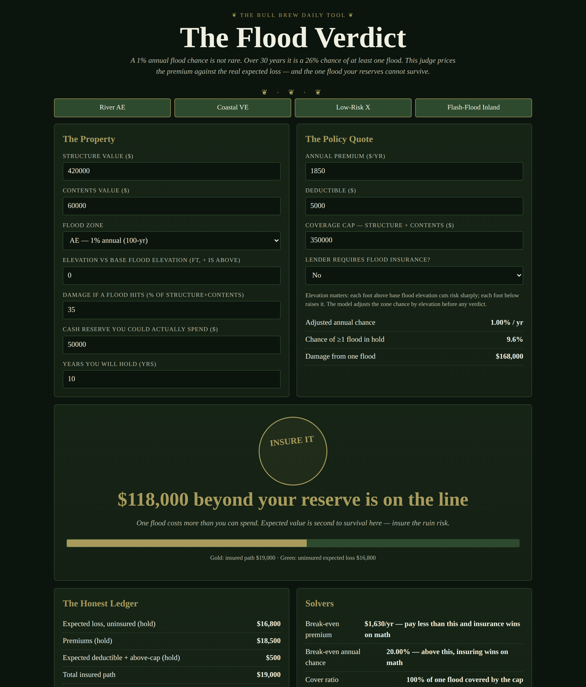

# The Flood Verdict

**Live:** https://thebullbrew.github.io/flood-verdict/
**Repo:** https://github.com/thebullbrew/flood-verdict

## What it does
Flood insurance vs self-insure, priced honestly. Enter your zone, elevation versus base flood elevation, structure and contents values, damage severity, reserve, and a real premium quote — it returns INSURE IT / SELF-INSURE / CLOSE CALL / UNDERINSURED seals, the chance of at least one flood over your hold, an honest ledger for both paths, break-even premium and break-even flood-chance solvers, and an annual-chance sensitivity table. Four presets, saveable cases, copy summary. Works offline as a PWA.

## The method
A "1% annual chance" flood is not rare over a mortgage: 1 − (1 − p)^years is 26% over 30 years. The tool adjusts the zone chance for elevation, prices one flood as damage % × (structure + contents), compares expected uninsured loss against premiums plus expected deductible and above-cap costs, and overrides pure expected value when one flood exceeds your reserve — survival beats spreadsheet math. If the cap covers under 40% of one flood, it calls the policy UNDERINSURED instead of pretending you are covered.

## How to run
Open `docs/index.html` in any browser, or visit the live link above. No build step, no backend, no accounts.
